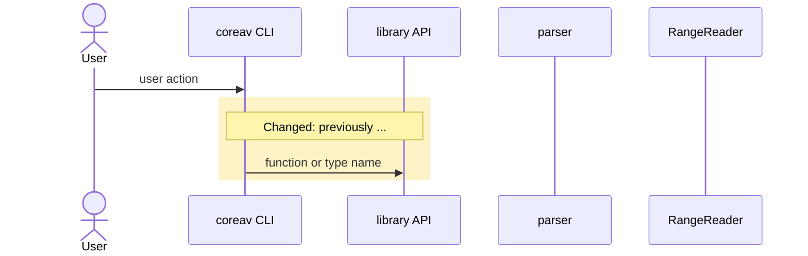

<!-- Title: type(scope): short English summary, using Conventional Commits types (feat, fix, docs, test, chore, refactor, perf, ci). Describe one outcome in 50 characters or fewer. Don't list several changes with `+`, `,` or `/`; put parameters, numbers and identifiers in the TL;DR or Decisions instead. Keep the whole title under 72 characters. -->
<!-- Writing: use plain English that a first-time reader understands in one pass. Avoid abbreviations and jargon shortcuts (write "refactoring", not "refac"). Keep code identifiers, product and project names, and commands exactly as written. -->
<!-- One rule: don't write what the diff already shows (architecture, call stacks, types, per-file changes). -->

## TL;DR

<!-- At most 3 bullets: what changes, for whom, and how. -->

-

## Background

<!-- Why this PR exists: only the situation before any code changed. Write whichever applies.
     If it started from a problem: the symptom (what goes wrong and how), who hit it and where (user, crate, CLI, CI, fuzzer), since when or how often, and the cause in one line if known.
     If it started from an intent: who wanted what and why (maintainer decision, user request, roadmap milestone, follow-up to an earlier PR), and why the request was narrowed to this PR's scope.
     Link sources (issues, discussions, fuzz findings, review comments). Solutions and alternatives go in Decisions, and the changes go in What changes; don't repeat them here. -->

## What changes

**What changes for users of the library or CLI?** Put before/after output here (for example CLI or JSON output).

**What does this cover, and what nearby areas did it deliberately leave alone?** Name crates, APIs, CLI commands, container formats, or spikes. If nothing nearby was left out, write "None (all affected areas)".

- Covered:
- Not covered:

**What must a person do after merging?** Release steps, version bumps, changelog entries, follow-up issues, manual checks. If nothing, write "None".

## How it works

<!-- For each user scenario, show which layers this change passes through and how it behaves. Use a Mermaid sequenceDiagram instead of prose; GitHub renders it.
     One scenario = one TL;DR bullet = one diagram (at most 3). Title each one in the user's words ("Probe a truncated MP4 file"), not with code names.
     Order participants from left to right along the architecture's layers, from the user down to storage. Drop layers it doesn't pass through.
     Label messages with function, type, or command names. Wrap only the segments this PR changed in a rect and add a Note saying "Changed: previously ..." or "New". Keep unchanged segments only as context.
     If the diff stays inside one layer and the behavior users see doesn't change, delete this section. Keep it in sync with the diff on every push. -->

Scenario 1: 

## Decisions

<!-- Why this approach, and what you knowingly left unfixed. Review bots should not re-raise anything written here. One bullet per decision: decision — rejected alternatives / known limitation — reason. No status tags such as "Review requested". Where a technical choice was uncertain, say that you picked the more reversible option. -->

-

## Needs the maintainer

<!-- Delete this section unless an item is on the maintainer's list: roadmap and stage-gate verdicts, positioning and messaging, outward-facing actions, licenses and the project's policies, spend above the limits, irreversible actions, the project rules. At most two items, each with a recommendation. Such a PR waits for the maintainer instead of being merged by an agent. -->

-

## Evidence

**Verification run**: commands and results (for example `cargo fmt --all --check`, `cargo clippy --workspace --all-targets -- -D warnings`, `cargo test --workspace`, `cargo deny check`, fuzzing). Write "Not run" for anything you didn't run.

**Links**: related issues, earlier or follow-up PRs, design notes, the roadmap sections and decisions this implements, entries in the site and port lists (`docs/unsafe-sites.md`), and any updates to the project rules.

- [ ] Every commit is signed off (`git commit -s`, DCO).
- [ ] I copied nothing from other implementations.
- [ ] I did not read git history or the `archive/m1-prototype` tag, except paths named in a port request.
