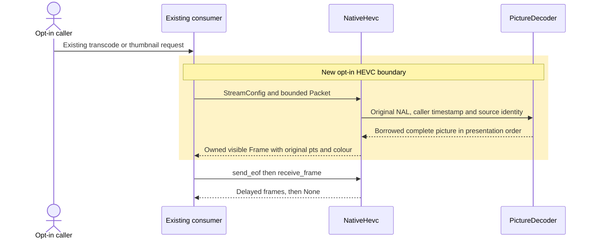

# HEVC native decode boundary

Status: milestone B, implemented by this change. This extends the scalar decoder in [the inter plan](hevc-inter.md) through [the decode boundary](decode.md). It is stacked on coreav-dev/coreav#429 until that change lands. Scalar-decoder evidence does not prove the proposed backend. Refs coreav-dev/coreav#26.

## Outcome and scope

An explicitly enabled native HEVC build decodes supported eight-bit Main and eight- or ten-bit Main10 packets through `coreav_decode::Backend` and `Decoder`. It supplies presentation-order `Frame` values to the existing transcode and thumbnail consumers. The backend preserves caller timestamps, actual sample depth, signalled crop and colour. It drains delayed pictures exactly once and becomes terminal after any failed operation. A selected native decode never restarts another decoder after a packet, configuration, allocation, limit or deadline error.

This work includes the backend, optional consumer registration, keyframe-only thumbnails, C1/C2/C5 through the boundary and a bounded boundary fuzz target. It does not add SIMD, scheduling, hardware decode, an encoder, a timing gate, new media or fixture recipes. Defaults, `release-default`, `release-full`, release recipes and licences remain unchanged. Default builds keep inspecting HEVC through the existing container owners only: `coreav-hevc` exposes its header parser solely under `native-hevc`, which also enables the kernels, so no default or release build may depend on it. `scripts/patent_free_check.py` lists `coreav-hevc`, `coreav-kernels-hevc` and `coreav-backend-hevc` as patented and checks every default member build, the npm build, `release-default` and `release-full` against them. `coreav-backend-apple` depends on `coreav-hevc/native-hevc` unconditionally; it is outside the workspace with no consumers, and wiring it into a default build would fail that check.

Use the pinned ITU-T H.265 V11 January 2026 specification, SHA-256 `78b093480e178a2b99d8cb7499934240f359c50c6d09568f8be651bc1151d4d2`, the existing conformance data and our own source. The relevant existing processes are picture activation, reference/output ordering, random access and conformance-window/VUI interpretation. Existing configuration-record and container owners remain authoritative for their formats. Do not read HM, FFmpeg, libde265 or any other HEVC implementation source. The pinned FFmpeg/ffprobe 9.0.2 binaries remain black-box oracles.

## Caller first

The library caller constructs `NativeHevc::new()`, supplies it to the existing `coreav_decode::open` backend list, sends original access-unit packets, interleaves `receive_frame`, and finishes with `send_eof` followed by draining `receive_frame`. An explicit native-only policy is used in the correctness tests. No new backend-kind enum or command-line spelling is needed: `Codec::Hevc` and `BackendKind::Native` already exist.

The CLI adds only an explicit `native-hevc` Cargo feature forwarding to the backend and the existing thumbnail/transcode build prerequisites. Its existing backend registry registers HEVC only under that feature. It adds no `ffmpeg`/`ffprobe` vocabulary, encoder value or change to fallback or strict-safe policy. Library consumers continue accepting injected backends rather than depending unconditionally on the codec. No command that is native today may start refusing or falling back.

## Ownership and interfaces

| Owner | Change |
|---|---|
| New `coreav-backend-hevc` | Configuration/framing adaptation, `Backend`/`Decoder`, output packing, queue accounting and lifecycle. No container dependency or independent slice parser. |
| `coreav-hevc` | The existing parameter, reconstruction and DPB owners remain the only semantic decoder. Add bounded caller-origin propagation and any lowered reference or external-memory reservation hooks required by the boundary. |
| `coreav-decode` and `coreav-frame` | Reuse `StreamConfig`, `Packet`, `Limits`, `DecoderInfo`, `Frame`, `Picture` and `ColorInfo`. Do not add a new general decoder framework. |
| CLI backend registry | Feature-gated construction of the backend; existing selection order and non-HEVC choices remain unchanged. |
| Thumbnail reader and selector | Preserve `select::offered` as the sole keyframe eligibility owner. Validate the chosen HEVC start without choosing a different image. |
| Transcode pipeline | Reuse backend injection, packet clocks, encoder-input validation and terminal-error handling. Do not introduce a parallel HEVC pipeline. |
| Existing HEVC drivers and full tier | Add boundary output and random-access proof using the same sources, oracle qualification, identity checks and four C2 shards. |

The proposed public entry is `NativeHevc::new()`, implementing the existing `Backend` trait. The backend crate has no enabled native feature by default. Its explicit `native-hevc` feature enables its optional `coreav-hevc` dependency and that dependency's same-named feature; CLI forwarding is explicit. Backend examples and tests own boundary harness dependencies, avoiding a reverse development dependency from the codec that could silently activate it in feature-disabled tests.

### Picture identity without a second parser

PTS can repeat or be absent, so it cannot identify a discard request or a queued picture. Assign each input access unit a checked monotonic source identifier. Add `PictureDecoder::read_nal_with_origin`, taking the original NAL bytes, the unchanged `Option<i64>` timestamp, an opaque `u64` origin and the existing output callback. Add `DecodedPicture.origin: Option<u64>`. The existing `read_nal` remains supported and uses the same implementation with no origin; configuration-only input has no picture origin.

Latch timestamp and origin when the existing slice owner starts the picture and carry them through the existing DPB output metadata. The backend encodes the packet number and discard bit into that opaque tag with checked arithmetic, rather than retaining a heap ledger that can leak auxiliary or non-output packet entries. It cannot maintain a second DPB, parse slice headers again, repurpose timestamps as tags or manufacture a missing origin. Reordered, suppressed and non-output pictures retain the codec's original coded identities. Reject malformed access-unit structure rather than guessing which packet owns a picture: a picture whose slice segments arrive in two packets fails with `picture_origin_changed`, and a packet holding two pictures fails with `multiple_pictures_in_access_unit`. Both are new opt-in refusals, matching the access-unit packet contract every existing caller already meets.

### Configuration and packet framing

Accept HEVC `StreamConfig` values with original `hvcC` configuration or the existing Annex B packet form without configuration. Validate configuration version, array extents, length-size encoding, NAL lengths and operational caps before allocation. An `hvcC` record holds at most 64 arrays, each of a distinct parameter-set or SEI type, and at most 4,096 NAL units in total; its length size is one, two or four bytes, and trailing bytes are refused. A packet holds at most 4,096 NAL units, each no larger than the smaller of the caller's packet limit and the codec's 16 MiB NAL cap. Caller `Limits` above a codec cap are lowered to it, never raised, and never refused merely for exceeding it; the codec's dimension, pixel, reference, NAL, memory and frame-byte caps then apply. Feed configuration NALs through the shared codec owner; container profile labels alone cannot grant admission. Reuse existing `LengthPrefixed`, `AnnexB` and NAL-header validation. In-band parameter-set changes remain subject to the codec's active-picture/CVS rules.

Keep the milestone-4 terminal-zero framing rule in one shared boundary helper where the production backend and test adapter both need it. Check the original NAL size before trimming, preserve complete encapsulated CABAC zero words, and never repair entropy or replace a NAL. Configuration and packet failures remain typed. A bounded framing or origin receipt is not an independent semantic parser.

The backend preserves `Packet.pts` in its original caller time scale. It does not rescale, round, apply edits or fit an oracle offset. Production readers keep their clock ownership. Boundary comparisons independently reconcile that presentation clock with the oracle using the established source-bound mapping.

### Frames, crop and colour

The codec callback borrows coded planes. The adapter creates an owned visible `Picture` with checked dimensions, strides and fallible allocation: `YUV420P` for eight-bit samples and the existing little-endian ten-bit planar format for ten-bit samples. It applies the SPS conformance window once, in the correct luma/chroma units; container dimensions cannot silently apply a second crop. No truncation to eight bits, invented pixels or display rotation occurs in the backend.

Map VUI primaries, transfer, matrix, range and chroma location into `ColorInfo`, preserving absence and reserved/unspecified semantics. Use the existing field-by-field container inheritance where stream declarations are absent. Keep sample aspect ratio and display transformation with the existing reader/render owners; an invalid-SAR warning must not become fabricated display metadata. Test declared, absent, conflicting and changing colour/crop records and both sample depths through actual `Frame` values.

### Lifecycle and resource accounting

The adapter has active, draining, ended and failed states, but no independent picture-order state. Before EOF, `receive_frame` returns available presentation-order output or `None` without waiting. The first `send_eof` calls codec finish once and queues its delayed output. Repeated successful EOF is idempotent; a drained session returns `None`. A packet after EOF is an error, not a new sequence. Any framing, decode, callback, allocation, byte-limit or timeout failure closes the adapter, releases its decoder and undelivered queue, and makes every later decoding operation fail. Frames already delivered remain valid; `info()` remains truthful and available.

Map the boundary's packet, geometry, frame, pending, cumulative decoded-byte, reference, memory and deadline limits to their existing meanings. Caller `discard` suppresses transfer, not the reconstruction or filtering of needed references. Never skip coded work merely because a frame will not be returned. Native HEVC must not inherit a consumer's disposable-packet shortcut unless its dependency safety is established by the shared codec; existing other-backend behavior stays unchanged.

One request memory account covers live codec/DPB capacities, packet-origin metadata, queued owned frames, packing scratch and the overlap while a borrowed picture is copied. Two independent full-sized caps do not establish this bound. Extend the codec's current charged-memory owner with a bounded caller reservation that remains visible during allocation and output callbacks; releasing a queue entry releases its reservation. Charge before allocation, include capacity rather than length, and lower rather than enlarge the caller's limits. Do not reserve an arbitrary fixed fraction that rejects otherwise admissible existing gate inputs. Reference-budget enforcement belongs at the shared SPS/DPB activation owner before it allocates or retains references.

`coreav_decode::Checked` currently terminates its wrapper for limit failures only. The new adapter must enforce its own all-error terminal contract even when opened directly, without changing other backends' behavior. Selection may consider other candidates only before a native decoder is selected, under the existing policy. A selected native error never authorizes a compatibility fallback.

## Random access and keyframe-only thumbnails

`select::offered` remains the only owner of which sample may be offered as the thumbnail image, including presentation membership and known time. Keep its chosen source identity and timestamp. The backend validates the selected original access unit and parameter state; it never substitutes a nearby frame when that start is unsafe. Container sync flags alone are not native decoding proof.

Exercise admitted IDR, BLA and CRA starts with the existing NoRaslOutputFlag, leading-picture and reference rules. Do not invent absent prior references or make a RASL picture available merely because a packet is labelled keyframe. An unsafe or unsupported selected start gives an explicit refusal, not an approximate thumbnail or a second decoder. Keyframe-only work may drain the selected original access unit; it must not discard an error after obtaining an early candidate image. Default non-exact selection and existing exact-selection policy remain unchanged. In a `native-hevc` build, an unsafe selected start is therefore an explicit refusal, while a default build still produces an image for the same request through its sandboxed fallback. That difference follows from "a selected native error never authorizes a fallback" and is not a regression.

Builds without `native-hevc` must produce byte-identical existing H.264 and other-input results, including output bytes, timestamps, selected packet identity, diagnostics and fallback disposition. Feature-enabled builds must also retain existing non-HEVC native paths. Narrow any shared-reader change to the new native HEVC route and prove the unchanged controls.

## Verification and delivery

1. Commit this plan first and review it before backend implementation. Implement the backend and source/memory hooks, then lifecycle and typed-limit tests, without adding another parser or DPB.
2. Wire the explicit feature and existing consumers, keeping all default and release feature lists and licences unchanged. Test direct backend use and the existing checked wrapper, including duplicate/missing PTS, auxiliary packets, discard with retained references, multiple NALs, failed callbacks, each lowered budget, repeated EOF, packets after EOF and every operation after failure.
3. Run complete C1 through the real boundary on all admitted original streams. The conformance bitstreams are raw Annex B, so the harness frames them into access-unit packets in clause 7.4.2.4.4 order: a packet ends before a parameter-set, access-unit-delimiter, prefix-SEI or other NAL that the clause places ahead of a new picture's first slice, or before a slice segment with `first_slice_segment_in_pic_flag` set, so every slice segment of a picture shares one packet. One NAL per packet would split multi-slice pictures and is never used; retaining the current source exclusions and unequal-depth refusal. Keep G3 and the raw scalar regression. Preserve published coded-picture/whole-output anchors and applicable SEI checks; never compare a cropped frame hash with a coded-picture reference as if their layouts were equal. Independently check each boundary-visible frame against the correctly cropped, source-bound reference and retain its original coded/output identity.
4. Run C2 through the real backend and reader for every fixed-roster identity, with the original 120-packet and eight EOF obligations. Retain exact clock, presentation-order, count, depth, packing and MD5 checks and all four shards. Keep existing container follow-ups visible without pixel credit; introduce no new exclusions or decoder-error follow-ups. A raw-codec result cannot stand in for a boundary result.
5. Add C5 using random-access points from the original conformance and already-held corpus data: compare native starts and keyframe-only thumbnails with full native decode for the identical selected source picture, bytes and PTS. Include CRA leading pictures, output-suppressed pictures, changed or unavailable parameter state, dishonest sync flags, duplicate PTS and refusal controls. Dishonest sync flags and duplicate PTS come only from relabelling existing packets in memory: a non-IRAP access unit is sent first with `keyframe` set, and the access unit after a selected keyframe is sent with that keyframe's timestamp and `discard` set. No bytes are written and nothing here is a fixture recipe. Preserve unavailable coverage explicitly rather than generating replacement streams or inventing output indices.
6. Add a bounded standalone backend fuzz target covering configuration, packet bytes and send/receive/EOF/error/drop sequences. Compile it locally and run affected-target CI; no local hostile-media decoding or long fuzz campaign. Check that failures release queued owners and that reordered/discarded origins never acquire another packet's metadata.
7. Verify normal/build dependency graphs and linked artifacts for default, `release-default` and `release-full`, separately from explicit `native-hevc`. Extend the existing patent-free checks for the new optional backend without weakening them. Prove the old consumer paths unchanged and record native backend receipts and a failing fallback spy in native-selected integration tests. A failed native-selected test cannot receive credit from FFmpeg.

Reuse the existing acquired registrations, private-output protection, pinned binary oracle and full-tier dispatch procedure. All real-media, malformed-media and fuzz execution stays on Linux Actions; the workstation runs builds and existing self-written or mocked unit controls only. Extend `FULL_WORKFLOWS` and `PROOF_STEPS` for the actual new boundary/C5 proof steps so smoke, skipped steps, missing shards and old-head successes cannot satisfy the gate. This work makes no speed or release-readiness claim.

The draft starts on the exact parent of coreav-dev/coreav#429. After that PR merges, rebase only this milestone's commits onto main and retarget the draft; do not replay the parent implementation or push to its branch. Merge current main before shared-consumer implementation and coordinate reader changes with their owner. Plan, implementation, fixes and verification remain in this one milestone PR. The milestone table in [the HEVC plan](hevc.md) estimates two pull requests for milestone B; one PR is used because the backend, its consumers and its boundary evidence form one work unit that cannot be verified in parts.

## Alternatives considered

- A separate backend reuses the established packet boundary and keeps patent-sensitive dependencies optional. Direct consumer calls into `PictureDecoder` were rejected because they would duplicate framing, draining, limits and error handling across thumbnail and transcode paths.
- Bounded owned output is chosen before zero-copy export because the current codec callback borrows DPB-owned samples. Letting those borrows escape would couple caller-held frames to reference storage and invalidation. Actual combined-memory accounting is required; zero-copy allocator redesign is not a prerequisite for this milestone.
- Caller-origin metadata is preferred to PTS lookup or a second slice parser because timestamps can repeat or be absent and leading pictures can be suppressed. The existing shared picture-start owner already knows which origin belongs to the picture.
