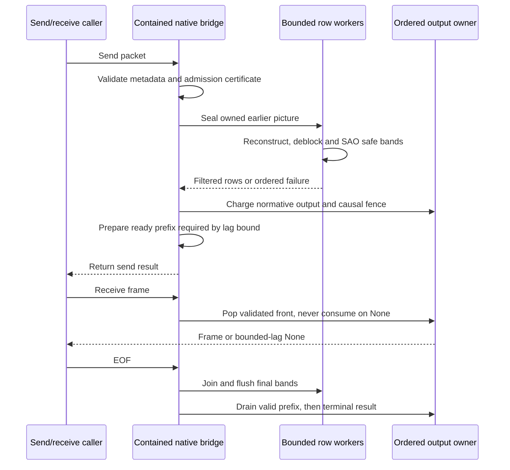

# HEVC picture scheduling

## Scope

This note describes bounded picture-level concurrency in the opt-in native HEVC decoder. The existing decoder thread option remains the only CLI control. Build defaults, syntax admission, decoder isolation, filter arithmetic and prediction arithmetic stay unchanged.

The initial complete-reference stage overlapped independent intra pictures and pictures sharing older completed anchors, including streams without WPP or tiles. It could not overlap a chain in which each picture references its immediate predecessor. The current raster-row bridge below adds dependent-chain overlap. No input-coverage or speed claim follows from adding a queue. Verification must observe simultaneous picture reconstruction and report the actual eligible-picture share.

## Current boundary

`PictureDecoder::read_nal` validates headers and reconstructs each slice before returning. On the next first slice, `StreamCore` validates that slice header before finalizing the previous picture. `Dpb` permits only one pending attachment, publishes only complete filtered samples and owns POC, reference marking and presentation-order bumps.

Queued work cannot retain the current `SliceInput`: it borrows the local RBSP, entry array, tile layout and active parameter-set slots. Nor can a worker borrow the mutable DPB while the caller admits another picture. These ownership boundaries must change before dispatch can overlap pictures.

The synchronous `read_nal` contract is unchanged. The native backend uses `read_nal_scheduled` through its existing send/receive protocol. That path may defer reconstruction completion and failures until synchronization, but selects the same first failure and valid output prefix as serial execution. Header and packet validation, callback execution and external output reservations remain caller-owned. A caller reporting its own framing or read error first calls `synchronize_pending` to preserve an earlier reconstruction failure. Changing thread count does not silently make the synchronous API asynchronous.

## Ownership and data flow

The caller owns one parser and one normative DPB. A private scheduler in `decoder/scheduler.rs` owns bounded picture jobs, their input storage, started worker handles and ordered outcomes. Workers own a `Frame`, immutable input and complete reference snapshots. They never mutate the normative DPB, invoke callbacks or reserve external output memory.

`Work` moves a `Frame`, owned slice operations, ready reference publications and reserved entropy work into one reconstruction task. `Job` retains its coded index, timestamp, origin, reservation and join handle or completed `Outcome`. `ReadyReferences` pins immutable publications identified by coded index and POC, not a recyclable DPB slot.

`OwnedSlice` owns the bytes, entry lengths, activated parameters and layout required by the existing slice walker. Its charged inline hash slot can retain one decoded-picture-hash SEI at the exact position after that slice. Requested and actual capacities are checked before ownership transfers. Reference storage remains pinned through the last borrowing job even if normative reference marking removes that picture. A single reference-reader interface serves the serial DPB and ready snapshots; reconstruction arithmetic is shared rather than copied.

The DPB still owns the current picture's pending header attachment. At a boundary, that attachment receives a validated immutable publication slot, while the scheduler tracks outstanding reconstructions by coded index. Reference marking, missing-reference validation and output selection remain in the existing DPB owner. A picture runs only after every selected reference has complete filtered samples and motion fields. Neither completion order nor DPB removal can release a reference still used by a job.

The caller reconciles results at synchronization points: required reference acquisition, output bumps, memory or entropy reservation pressure, explicit drain, end-of-sequence transitions and failure. It waits for the required serial prefix before committing counters, sample attachments and output callbacks. To preserve the output prefix before a later failure, impending output bumps currently synchronize outstanding work conservatively. Ordinary reorder pressure can therefore limit overlap as well as reference dependencies. Suffix hashes stay associated with their original picture and are checked before that picture can become an output or reference.

All SEI syntax is parsed on the caller. Informational prefix and suffix SEI, including picture timing, does not synchronize reconstruction. The implemented sample-dependent SEI is decoded-picture-hash (payload type 132, including reserved hash types): a picture job verifies it in slice order after reconstructing the associated samples, not at parser arrival. A second hash at the same slice position reconciles the first before applying the existing duplicate-placement refusal. Malformed SEI also reconciles earlier work before reporting its parser error. No new SEI interpretation or syntax admission is introduced.

## Ordering and limits

Operation order is finer than picture order. A later first-slice header is validated before the previous picture's boundary finalization, while an earlier slice's reconstruction failure precedes that later header. Queued slices are reconciled without premature boundary finalization when header or caller validation fails. Earlier jobs are joined before a later result becomes authoritative, and the first error is latched. A later worker's error never cancels earlier undecided work. Worker panics use the existing internal-error mapping, and every started worker is joined before teardown.

Dropping a session joins running whole-picture jobs and can block until they finish. Workers check an optional deadline cooperatively; the default has no deadline, and a configured deadline does not interrupt a join or provide a hard teardown timeout. There is no separate cancellation flag.

The execution limit is `min(requested_threads, 16, available_parallelism)`, with a one-worker fallback when host capacity is unavailable. The caller counts against this limit whenever it executes reconstruction. Frame and WPP work share this one limit; the first implementation selects one scheduling level for a group instead of nesting pools. An explicit request above host capacity must not create oversubscription.

Cold serial admission remains authoritative. Scheduler records, owned input, retained reference owners, working pictures, bounded stacks and finalization scratch are reserved without double-counting shared samples. Before optional work could make a required allocation fail, the caller reconciles it and releases optional storage. A decode admitted without scheduling remains admitted with scheduling at the same caller limit. The original typed accounting layout fixes the cold allowance even when optional counters are added; physical-envelope tests check the actual storage against it. Independent cold decodes test admission boundaries. There is no pressure-sensitive worker-cache policy.

Reserve the smaller of the conservative complete entropy-work bound and the picture's remaining hard bin limit before speculative dispatch. Both successful and failing jobs stop within that reservation; a large byte-derived bound alone cannot exclude an otherwise eligible picture. Keep independent stream and picture limits. If the reservation cannot fit the remaining stream allowance after outstanding reservations, reconcile prior consumption and continue through the existing serial budget path. Reconcile actual bin counts and map exhausted stream limits in operation order rather than allowing a racing shared counter to select a failure. Allocation and deadline failures remain terminal, with no fallback to another decoder.

## Reference-only overlap ceiling

Before implementing the deferred-output amendment, replay headers on all thirty existing reference inputs at the same thirty-two-picture cap and retain their prepared-input hashes. `thread_dependencies_only` selects this Actions-only path without sample reconstruction, timing, conformance or sanitizer work. Its acquisition limits and sealed metadata handling are shared with diagnostics.

Record real coded-picture identities and POCs, every used current-RPS member, and the union of active reference lists across independent slice segments. I slices add no active reference; dependent segments inherit their independent header. Use the existing DPB and active-list owners, not a second POC or list-derivation implementation. Skipped reconstruction pictures remain visible in the coded roster but do not become work vertices. A malformed, missing, forward or mismatched dependency fails the record.

Report RPS and active-list graphs separately. Maximum DAG antichain width is an optimistic bound that permits arbitrary header lookahead. Coded-order admission is narrower: a picture can remain outstanding only until its first later dependent blocks the caller. Count duration-independent coexistence opportunities within that interval and distinguish non-WPP candidate pairs. The unit-cost work/span bound uses the unconstrained DAG critical path, independently of worker count and coded-order admission. Separately simulate coded-order dispatch at 1/2/4/8 workers with explicitly equal, unit-duration pictures, reporting overlap, steps and peak workers. Neither the DAG bound nor the dispatch simulation is measured throughput or a duration-independent speedup. Ignore output, memory, SEI and presentation barriers in this analysis; it does not authorize early reference publication.

The ceiling must be read before deciding whether an output-journal redesign is useful. A serial reference chain cannot benefit from removing output drains; overlapping it would require a separate row-level reference-publication design.

The second replay adds normative output events and assumes one coded-picture access unit per send, followed by receive-until-`None`. Admit the current picture's job, then join every earlier submitted picture covered by that call's output events before returning their frames. EOF joins the remaining prefix. Report modeled steps and peak workers at four threads separately from the no-output-barrier model. Picture-ready admission remains optimistic: the existing scheduler seals a picture at the next boundary, so this model does not prove that its proposed submission timing is already implemented or that arbitrary packet grouping has the same ceiling.

Report existing seal timing separately: call `i` first submits picture `i - 1`, then requires the current picture's references before accepting its input, and finally applies the same output-receive fence. The EOF call submits the last picture and completes every job. The used-RPS graph matches the existing `Scheduler::required_references` gate; substituting active references is a separate hypothetical model. These equal-duration replays still omit memory, SEI and output-processing costs and are not full implementation simulations.

A separate four-worker study permits at most three normative output events to remain unconsumed. Its abstract producer/consumer rendezvous consumes the oldest causally completed record before admitting a fourth; ordinary receive steps consume already-ready records without waiting, and EOF drains all records. Count the maximum held output records and report current-picture-ready and delayed-sealing schedules separately. This is an optimistic frame-count/backpressure model, not an implementation of the existing send/receive API or a proof of a byte-budget rule. Publishing a record without consumption does not free its slot.

The row-reference variant must use decoded motion-vector footprints and CTU-row dependencies if those are available. The retained header graph contains neither, so its explicit fallback keeps worst-case full-picture reference dependencies and produces the same schedule as the whole-reference variant. Equality under that fallback does not establish that actual row publication has no benefit. No row-level sample publication is implemented or authorized by a model.

An additional diagnostic-only decode captures those missing reads on the twenty-four non-WPP inputs, once each at the existing thirty-two-picture cap. It runs synchronous reconstruction and records the actual clipped interpolation support from the kernel, including chroma scaling and fractional-filter margins, plus separate collocated motion-field row reads. Stable coded index and POC identify each reference; the collector retains each current CTU row's maximum row per reference. It is bounded to thirty-two pictures, 2,048 rows per picture and sixteen references per row, and it is compiled out with the existing diagnostic cfg. Generated probes verify the kernel's last read row with poisoned samples, preserve decoded output and reject a missing recording hook. Ordinary binaries reject the row-inspection mode.

Capture refuses a multi-worker decoder before reconstruction, and extraction rejects an observed worker count other than one. Diagnostic identity checks are fallible and can stop a trace where an ordinary run would continue or fail differently; this mode never judges correctness. Ordinary Linux pull-request CI runs the cfg-gated extraction and kernel tests with exact success witnesses.

Replay four-worker row tasks with equal row costs including amortized filtering work. Rows within a picture stay sequential. In the hypothetical incremental-filter model, a sample dependency on reference row `q` waits for reconstructed row `min(q + 1, last)` to cover horizontal deblocking and SAO's one-pixel neighbour margin; motion-field reads wait only for their reconstructed row. Report a separately labelled two-row lookahead sensitivity and a complete-reference control. Actual filtering remains whole-picture: this is not a claim that incremental filtering or its necessary unfiltered-border storage already exists. Tiled pictures conservatively retain atomic whole-picture readiness and publication rather than assuming a raster-row entropy order.

Report row-unit work, span and scheduled steps, normalized picture steps, peak workers and the lag-three pending-record bound for both submission timings. Row variants hypothetically replace the current full-reference input gate with row readiness; the control retains that gate. Distinguish the modeled serial-work/steps ratio from the four-worker DAG ceiling `min(4, work / span)`. Both are conditional model quantities, not measured speedups or a byte-budget proof. Keep the original source and prepared-input hashes and the request cap; no pipeline or reference-publication change follows from collecting the trace.

## Raster-row amendment: design rationale

This amendment specifies the filtered raster-row bridge described under “Current bridge implementation”. It builds on the actual-read model rather than the rejected serial-exact output journal below. Existing `PictureDecoder` methods, their callback behavior, typed cold admission, build defaults and the supported API remain unchanged. Only the contained native-backend bridge may select this path.

### Output contract and caller boundary

At more than one effective worker, permit bounded output latency. Let `V(c)` be the ordered frames returned by the real one-worker native decoder through caller operation `c`, for the same send/receive/EOF sequence. Let `R(c)` be the frames actually returned by the native row path. `R(c)` must be an exact prefix of `V(c)`, including samples, dimensions, pixel format, timestamps and color. These are the fields exposed by `Frame`. Packet origin and decoder warnings are separate diagnostic observations, not returned-frame fields. Check origin-driven discard selection and warning identity through those observations without adding fields to the supported API. Its frame-count debt is at most `L = threads - 1`; the host-bounded effective worker count may impose a smaller bound. Once EOF/drain finishes, debt is zero. One effective worker has no output lag. At every worker count, native HEVC preserves the validated pre-failure frames before the same terminal error; this corrects the old one-worker queue-clear behavior rather than treating it as the oracle.

Lag changes availability, not content or failure selection. Every frame whose normative output event precedes the first serial failure remains receivable in order, followed by the same terminal result. No frame after that failure becomes observable. Suppressed/discarded outputs neither create frame debt nor consume pending/decoded output bytes; their causal ordering still matters. A later job completing first does not commit an output, free a pending slot or move the serial failure boundary.

A failing send or EOF reports its error immediately. The caller can then receive the validated prefix until receive reports that same latched error. There is no intervening `None` and no promise that the caller has received all those frames before the failing send returns. The later-activation memory refusal below is the sole exception to terminal-result and admission equality with one-worker decoding: the row path may refuse while direct decoding continues. Up to that activation, frame-prefix and debt rules still apply. At the refusal, preserve every valid prior-picture output, select any earlier serial failure first, and emit nothing from the refused current picture. No other serial-result difference is permitted.

Preserve the shared pre-EOF nonblocking `receive_frame` contract. Receive can return `None` within the permitted debt, but cannot wait for reconstruction to make a frame ready. The caller-owned send/synchronization path must prepare a causally validated ready prefix before returning whenever additional `None` responses would exceed the debt allowance. EOF joins all work and makes every valid output drainable; receive after EOF may wait as already documented. Do not revive the rejected pre-EOF blocking-receive exception.

The implementation needs an ordinal ledger derived from the existing normative output owner, not a second DPB/output-order implementation. It records output events, virtual serial receive opportunities, actually returned frames and their byte charges. A `Some` transfers only the oldest validated frame; a `None` cannot discard, consume or pretend to return one. Tests run a real synchronous decoder as the oracle for `V(c)` rather than trusting the ledger's own counters.

### Row ownership: selected conservative shape

The first producer stage converted complete-reference jobs when its extra buffers and row-store record fit within the job's existing full-component SAO allowance. Conversion moves the full planes and cells into the shared backing, retains one CTU metadata vector and reuses the original scratch. If conversion cannot fit, it returns the unchanged frame for the whole-picture path. The producer owns filter ordering, saved borders and row commits. The current native bridge also uses its row publications for dependent-picture overlap, with bounded output lag and continuation admission.

Considered immutable separately allocated row bands versus one contiguous picture store. Separate immutable bands would replace the current plane owner and require a gather/window interface in interpolation and output packing. Select a shared contiguous store with read locks for consumers and short write holds only for band commits/publication. The producer reconstructs a bounded band privately without holding the store lock, including while waiting for another reference, then copies that band into the backing store. This is a charged transient row-band copy, not a retained second full picture. Readers must not stall behind an entire row's reconstruction or reference wait. The row model does not measure these copy/lock costs. Do not add unsafe aliases to make it look like the model.

The private row store uses coded index, POC and generation to identify its backing. Its progress owner separates reconstructed motion from filtered samples. Scoped reference guards expose only the requested capability. `decoder::rows::Rows` owns the bounded pending window and ordinal ledger. The ordinary `Dpb` and `StreamCore` layouts stay unchanged. Instead of a second identity table, the existing heap publication optionally owns a row store on the threaded path. Complete stores move their vectors into the ordinary retained-picture owner without copying sample planes. Outstanding guards and owners keep that generation alive through the transition.

The ownership sketch is not code to compile. Frontiers are exclusive luma-row endpoints and advance only after a complete CTU row, including a partial final row. Zero publishes no row:

```rust
struct Progress { motion: usize, filtered: usize, outcome: Outcome }
enum Outcome { Building, Finishing, Complete, Failed }
struct RowStore {
    identity: ReferenceIdentity,
    generation: u64,
    storage: RwLock<Option<RetainedPicture>>,
    completed: OnceLock<RetainedPicture>,
    progress: Mutex<Progress>,
    changed: Condvar,
}
enum ReadPicture<'a> {
    Complete(&'a RetainedPicture),
    Building(RwLockReadGuard<'a, Option<RetainedPicture>>),
}
struct ReferenceRead<'a> { picture: ReadPicture<'a>, support: ReadSupport }
```

Only the producer's non-clonable `RowPublisher` can commit a building band or advance its frontiers. Each commit includes every dirty halo row in the band above, but never writes its published prefix. Its private entropy cursor, band and unfiltered borders survive between short store accesses. The ordinary `Frame` layout remains unchanged. `RowStore::read` waits for the requested motion or component-sample capability and returns a scoped guard. Commits and failure notify all waiters, including when the publisher is dropped. The progress owner records completion or failure. A complete view and a row view use the same allocation owner, not separately charged copies. The guard exposes no mutable data or unrestricted future-row slice to its caller.

Keep next-boundary job sealing initially: a worker receives the existing owned slice operations and parameter snapshots, not syntax commands for future packets. It owns its CABAC cursor on its stack and resumes the existing traversal at a validated CTU boundary. Releasing the picture lock between completed rows must not restart CABAC, copy contexts, reset QP or require a self-referential input object. A scoped row step borrows the owned slice and picture only while working. Independent/dependent slice segments can divide a row; readiness advances only after every required CTU is reconstructed and the contiguous prefix is valid, never merely at NAL end. Missing CTUs and malformed segments retain their original error positions.

Motion-field readiness and sample readiness are different capabilities. A collocated-cell probe waits for the reconstructed motion frontier even if motion selection ultimately finds no usable vector. Motion compensation waits for the complete clipped support of each component/list, including signed vertical reach, fractional luma/chroma support, chroma-to-luma scaling and edge replication. Factor the existing interpolation-support calculation into one kernel owner used by both validation and readiness; do not derive a fixed row lead or maintain a second footprint formula in the scheduler. The scoped reference guard pins the identity and dimensions used by that calculation.

Wait on the progress mutex/condition variable without holding any sample lock, then recheck generation, progress and failure while acquiring the read guard. Hold at most one reference-store guard during a kernel call and release it before waiting for another. Reference edges strictly descend in coded identity. A producer finishes its short storage write and releases that lock before advancing the progress frontier and notifying waiters. No guard or pointer outlives its lock. A failed producer wakes every dependent; dependents report a private dependency-failed outcome while the caller selects the producer's original error in serial order. Poisoned-lock, partial-start, deadline and drop paths must also wake and join every started worker, not leave a row waiter asleep forever.

There are no more row-worker threads than effective workers, and parked reference waits create no replacement worker. Start jobs in coded order. Run a job on the caller only after every earlier unfinished job is already running or complete; never occupy the caller with a later consumer while its producer remains unstarted. After partial spawn failure, the caller starts or completes the earliest remaining producer first and joins already started work. Thus the earliest unfinished producer has no unstarted dependency and must progress or report failure. Reference waits use deadline-bounded condition-variable waits, and terminal/drop notification wakes every waiter. Reconstruction/filter work on the caller consumes the same CPU allowance. WPP retains its existing path and worker limit, never a nested pool. Tiled pictures use the existing atomic whole-picture path and complete-reference publication. A raster consumer of a tiled producer waits for full completion; mixed groups cannot create another worker allowance.

### Filtered publication and current-picture prediction

The current finalizer does all vertical deblocking, all horizontal deblocking and then SAO. The row path must change only the traversal/ownership of those operations, preserving each scalar/kernel result and every slice/tile/picture boundary rule. Intra prediction still reads unfiltered current-picture samples: do not filter a band while any later permitted intra reference can read its original values.

For a raster band, reconstruct the required following CTU row before filtering/publishing its upper band. Complete vertical deblocking for every row touched by the upper band's horizontal edges, then all horizontal edges that can modify or supply SAO neighbours for that band, then SAO from deblocked, pre-SAO values. Retain the necessary unfiltered intra borders and pre-SAO neighbour rows in separately charged storage. A previous band's SAO output must never become the next band's SAO input. Process each edge once with the same protection and boundary flags; no future filter operation may write an already published band.

The diagnostic model's one-row lookahead covers the current bounded deblock and one-pixel SAO spatial neighbourhood at admitted CTU sizes; the two-row model is a sensitivity, not an implementation requirement or proof. The implementation must derive exact dirty/read/write extents from the filter owner and expose `FilteredThrough` only when that entire prefix is immutable. Flush the last band at picture completion. Motion cells may publish earlier, but an output or ordinary complete reference still waits for every row, inline hash check and coded-order causal fence. Consumers may speculatively use earlier rows of a producer that later fails; none of their dependent output may escape that failed fence.

### Lag, pending bytes and the admission gate

The caller's pending set is serial-equivalent rather than the physical output queue. Derive its ledger from the existing normative output owner, ignoring reconstruction status: enqueue unsuppressed output events in serial order, and count every actual receive call made while that virtual queue is nonempty as a virtual serial receive, regardless of `Some` or `None`. Virtual pending bytes are output-event bytes minus those virtual receives. Output debt is virtual receives minus real receives, bounded by `L`. A real receive during catch-up may return an older withheld frame after the virtual queue empties. Publication itself consumes neither queue.

`max_pending_bytes` checks that virtual pending set at the same output event as serial decoding, so caller-induced retention is identical. At the event, retain the existing frame check and charge cumulative `max_decoded_bytes`; neither is delayed until publication or receive. Reconcile earlier causal work before any limit refusal, because tentative later events may follow a deferred failure that serial would have reported first. The checked owner's frame recheck at real receive must be incapable of a new refusal after the backend's identical event-time check. The differential must establish all four conditions: one normative event owner, virtual receives, reconciliation before limits, and event-time frame/decoded checks.

**The two-frame example must succeed.** With equal frame bytes `b` and pending limit `2*b`, direct receive returns E1, then sends producing E2 and E3 fit without another receive. If row receive returns `None`, that call still consumes E1 from the virtual queue. E2/E3 occupy `2*b` of virtual pending and E1 is pipeline debt, not a third caller-pending frame. Its real storage stays charged to memory until actually received. The exact call schedule must succeed and ultimately return E1/E2/E3 in order; no frame is invisibly discarded.

The debt's packed capacities, source pins, row state, synchronization records, filter borders, input scratch, transient copies and worker stacks are physical pipeline memory under `max_memory_bytes`, with shared storage charged once. Reclassifying at most `L` outputs does not waive those charges. Joining workers can reclaim optional job/scratch state but cannot release a withheld output the caller has not received. Shrinking lag later only prevents new debt: it cannot repair an already withheld frame before a send-only burst or larger in-band SPS fills serial's memory budget.

The selected design chooses `L` at admission from the first active SPS's literal coded and visible geometry, depth and highest-sublayer DPB capacity, capped at effective workers minus one. Choose the largest nonnegative `L` satisfying `L * F + S <= max_memory_bytes` before creating debt. `F` is the SPS's packed output bound. `S` covers every permitted continuation under that SPS, not just the current picture or observed occupancy. It includes the highest-sublayer DPB capacity, the full caller-pending byte limit, the largest scratch and capacities any permitted PPS or slice can require, external reservations and bounded stacks. Include row workers, synchronization records, private bands, filter borders and retained source owners in their charged reservations. The packed-frame term alone does not cover an extra unfiltered working picture. Count each shared allocation owner once, using checked capacity arithmetic. If no positive lag fits at first admission, retain the ordinary direct path rather than rejecting a stream admitted by its existing cold rules. Neither inactive parameter-set arrival nor an arbitrary packet boundary selects the envelope.

The whole-future limit-maxima certificate gives zero useful lag under the default memory limits and is not the selected admission policy. The first-SPS certificate is conditional because a later activated SPS can increase packed output, working or reference storage, or DPB capacity while old debt remains pinned. At that activation, settle earlier work and reclaim optional pipeline storage. Then choose the largest future lag that fits the new continuation-wide envelope together with outstanding debt and its pins. Future lag may decrease to zero, which selects the direct path from then on without erasing old debt. Do not reserve the old future-lag allowance or retain optional state when deciding whether to refuse. Count shared allocation owners once, including old-geometry pins. A new coded video sequence does not erase those owners.

`Decoder::send_packet` returns only `Result<(), Error>`. The error kinds provide no retry or send-side backpressure result, and the native error path is terminal. This design does not invent a receive-first status, reinterpret a terminal error as retryable, or accept a packet that will never be decoded. Refuse a later activation only if its new envelope plus outstanding debt and unavoidable pins cannot fit even at zero future lag after optional storage is reclaimed. Place that decision after the new IRAP's slice-header processing outputs prior pictures, but before allocating the current picture's storage or starting its reconstruction. Those prior outputs remain receivable through the terminal-output handoff. The refusal must not ship before that handoff. A merely stored, unused SPS is not refused. The original one-worker/direct path keeps its ordinary geometry admission; the new condition belongs only to the selected lagged path.

This is a new potential refusal for a stream serial could accept under the original limits, not a proof of unchanged acceptance. Count its impact over the complete conformance roster and the registered commands that actually select native HEVC. A zero count on those sets does not prove that arbitrary in-band growth cannot reach it. Generated tests must exercise a reachable growth refusal, preserve all pre-failure output and the serial first-error precedence, and show that a fitting activation and an unused larger SPS are not refused. Include an activation that fits only after future lag becomes zero. Vary receive cadence so the same activation is tested with and without outstanding debt, including the IRAP's prior-picture outputs. The current implementation and remaining verification requirements are described below.

The in-call-only journal settles a send's output events before returning, so it has zero caller-visible lag and no cross-call output debt. Its lower ceiling remains separate from the measured lag-three model. It remains a design comparison rather than the selected implementation. Ordinary cold layouts and an allocation-free direct selection remain authoritative. Optional allocation failure falls back before visible state changes; never retry a side-effecting sink callback or expose a speculative allocation refusal as a serial resource failure.

### Terminal prefix and containment

Keep the accepted documentation-hidden, workspace-feature bridge with `publish = false`, no stability guarantee and no supported application API. It owns row slots, output ordinals, sink preparation and the budget decision; existing direct `PictureDecoder` methods and callback-free external-memory methods are not repurposed. The normal feature-graph check still excludes this bridge and `native-hevc` from release-default and release-full. No thread-count sentinel selects hidden semantics.

On first failure, stop admission, join workers, resolve earlier coded operations, finish only the valid output prefix and release later speculative state. Keep valid pre-failure frames receivable before the latched terminal result. The native backend now drops its live picture decoder but retains validated packed output on failure. The hidden `TerminalOutput` handoff moves that queue, its per-frame byte and capacity accounting, and the latched error to `Checked` before it drops the backend. It performs no queue or sample-plane copy. The residual owner retains no parser, worker, row store or reference pins. Receive drains it without new decode work or deadline checks, then returns the same error. Packet and EOF calls return that error without consuming output. Other backends' limit teardown and isolation stay unchanged.

The one-worker oracle preserves the same required pre-failure prefix as 2/4/8 workers; its old queue-clear error behavior is not retained. The hidden `native-hevc-private` checked-owner settlement capability reconciles a deferred reconstruction failure before a wrapper limit drops the backend. `checked_packet_refusal_settles_earlier_entropy_failure` tests truncated entropy followed by an oversized packet through `coreav_decode::open`, not only `NativeHevc::open`, at 1/2/4/8 requested workers. Settlement defaults to the original refusal for other backends and is absent without the private feature. Separate terminal-prefix regressions cover direct and checked opens, both packet framings, eight- and ten-bit samples, early and deferred receives, framing and entropy failures, decoded-output and wrapper-packet limits, and input after EOF. The queue-move and checked-owner destruction tests reject sample copies or a retained live backend. This handoff does not implement the row pipeline.



### Current bridge implementation

The native backend enables the workspace-only `native-hevc-rows-private` feature. Existing closure-based decoder entry points keep their synchronous or complete-reference contracts. The private sink prepares the real packed output entry at its normative event and fills it only after its entire coded fence succeeds. An optional heap owner in the scheduler holds emitted, validated, serial-received and returned ordinal frontiers. Its unresolved window holds at most `L + 1` entries during an event and has preallocated capacity of at least `W`. It pins publications, not duplicate picture storage. A successful receive consumes a virtual serial entry before an optional physical pop, never joins or waits, and releases external capacity only after a pop. Existing terminal-error cleanup, including a receive-time deadline failure, still settles the valid prefix and joins before releasing the core. EOF retains the ordinal owner until the real queue drains.

Admission qualifies the one-shot capacity premise at runtime, without a compiler identity gate or toolchain pin. Empty-`Vec` probes reserve the active geometry's plane, cell, CTU, row-band and scratch sizes, the observed source and entry lengths and their configured maxima, reference and operation-record bounds, and packed plane descriptors. Each probe checks that reported capacity equals its request and then frees the buffer. Probes run sequentially within the remaining live-memory allowance, and their peak is accounted. A mismatch at initial admission retains legacy output without panic; at a later activation it disables positive future lag before the existing old-debt decision. The forced-mismatch regression compares real legacy frames and semantic summaries with synchronous decoding.

This is runtime qualification of the selected request sizes on the current compiler and allocator, not a standard-library guarantee or a proof for every unseen future length. Every real allocation still charges its observed capacity defensively. The continuation envelope's one-shot size predictions are conditional on this qualified premise; they do not derive exact capacity from `try_reserve_exact`'s name.

Growth metadata does not use that premise. Admission reserves the pending window, job slots and packed-output ring, reads their actual capacities and charges those capacities before committing a plan. The output ring is reserved as a `Vec` and converted without reallocation to the existing `VecDeque`; a rejected candidate leaves the original queue untouched. Replacing an old ring charges both buffers until the old buffer is released. Rows mode never grows these buffers, and empty job slots persist until the row epoch retires. Each picture's transferred operation vector reserves its entire bounded record count once instead of growing with each slice. The cold queue path and no-copy terminal handoff remain unchanged.

For a candidate window of `W` jobs, sample and motion-cell owners are bounded by `(D - 1) + (W + 1) + W`: the pre-window DPB, live jobs plus current picture, and the event-time pin ring. Snapshots cannot recover evicted owners. Conversion moves backing without copying, jobs retire in coded order, idle cache is cleared, and atomic branches and changed active SPS identities settle first.

The base envelope includes the full caller-pending allowance, old queue capacities and transient descriptor growth, all packed plane records, global preactivation entry storage, maximum current-SPS substream ranges, packet-bounded owned sources, all slice and parameter snapshots, retained owners, row windows and borders, synchronization records and explicit stacks. A queued raster picture owns at most the smaller of CTU count and packet NAL count in operations; reaching that bound falls back through serial validation before another owned operation is allocated. Tiled and WPP pictures are atomic. Their optional worker setup is capped by the admitted total, with a separate admitted runtime reserve, and their cache is cleared before returning to row scheduling.

Old debt can migrate into larger frames even when future lag is zero. For old packed debt sizes `b[0..d]` and new packed size `F`, the migration peak is `max_k(sum(b[k..d]) + k * F)`, including both endpoints. The selected certificate is `L * F + S`, where `S = S_base + max(0, migration_peak - L * F)`. Thus the total covers both future lag and every old-debt replacement order. A changed active SPS settles and fills prior events before recomputing this bound. A zero-lag owner retires once old debt and unresolved events are gone; an initial zero-lag selection never creates it.

Generated tests force a dependent reader to wait before its predecessor's first publication and verify two executing raster jobs with serial-identical pixels and semantic counters. Reinstating the complete-reference barrier fails that test. A delayed output followed by an earlier coded CRC failure catches an own-picture-only fence, which otherwise leaks a frame. Native tests enumerate all short receive cadences at 1/2/4/8 requested workers, exercise a fitting growth that reduces future lag to zero, and exercise a reachable larger-envelope refusal against a successful one-worker continuation while preserving exactly the old output prefix. These fixtures do not establish corpus overlap or a speedup.

### Required implementation evidence, after design clearance

- A lag-aware per-call differential runs identical arbitrary send, receive and EOF sequences against direct decoding. It compares actual frames/metadata and the terminal result, checks prefix debt at every call, exact one-worker behavior, and zero debt at drain. The sole terminal-result exception is the specified later-activation memory refusal, tested separately against a successful one-worker continuation and its exact prior-output prefix. After a failing send or EOF, continue receiving until the latched error. Cover empty polls, partial drains, burst sends, multi-output packets, reorder, suppression, geometry changes, headers/framing/sink failures and wrapper-level limits. The two-frame E1/E2/E3 schedule must succeed.
- Mutations must fail when a virtual pending event or receive is omitted, frame/decoded checks move to publication, a finite memory-headroom guard falsely admits lag, publication is treated as consumption, the lag bound is exceeded, EOF loses debt, a causal fence covers only its output picture, or limit teardown erases the valid prefix. Keep the original reserve-failure stream-error and latency-only resumption mutations.
- Poison future rows, delay producers, use motion vectors/chroma support that cross row boundaries, and fail after partial row publication. Mutations publishing motion as filtered samples, omitting interpolation support, using SAO-mutated borders, filtering before intra reads finish, reusing a generation early or notifying no waiter on failure must fail. Tiled/WPP/mixed controls must preserve their original path and CPU limit.
- Find independent cold boundaries and observe actual allocations on all workers using the counting allocator, plus explicit stack reservations. Include hidden outputs, pins, filter borders, transient capacities, external reservations and changing input geometry. Return values and valid output prefixes must match serial acceptance at each boundary except the specified later-activation memory refusal. Test that exception without relaxing any other cold boundary; omitting any charge must fail. A final heap counter alone is insufficient.
- Before completion, observe actual reconstruction overlap and automatic/4T versus 1T wall/CPU timings on the same twenty-four prepared inputs on Actions, with hashes and work identity. Require complete 1/2/4/8 conformance identity, sanitizer stress, the lag-aware differential/mutations, green CI and independent review at the final head. Models, queued jobs and diagnostic counters cannot substitute for ordinary measured overlap. Every pending run retains a timer backstop of at most thirty minutes.

## Deferred-output amendment

This serial-exact alternative is not selected. Its required receive wait conflicts with the shared nonblocking contract, and a journal alone does not change next-boundary picture submission. This section, including its reservation and proof subsections, is retained history, not the raster-row implementation contract above. In particular its exact per-call multi-worker visibility requirement is not the bounded-lag contract. Its unsolved failure-handoff and physical-accounting obligations remain relevant review questions; they are not implemented by retaining this sketch.

The complete-reference implementation joined picture work at output bumps. This historical amendment specified a separate native-backend pipeline that could advance normative DPB metadata without immediately exposing the corresponding samples. Its serial-exact receive wait is not implemented; the selected bounded-lag bridge above preserves nonblocking receive instead.

### Boundary and workspace interface

Keep the existing direct decoder and its callback, polling, memory-reservation and error contracts unchanged. Only the native backend selects the new typed pipeline. There is no new CLI control, default feature, admission rule or fallback path. Complete-reference picture jobs, the shared CPU limit, WPP exclusivity and all reconstruction arithmetic remain unchanged.

A queue solely in `coreav-backend-hevc` cannot lift this barrier: the decoder joins work inside `Observer::output` before the backend callback gets control. Changing the existing scheduled method to defer arbitrary callbacks is also insufficient: `set_external_memory(bytes)` has no callback with which to publish and release deferred output under pressure. Neither approach preserves the existing contract.

Keep the journal, fences and DPB access private to `coreav-hevc`. The backend owns output buffers through a two-phase sink rather than an arbitrary delayed callback. The intended workspace-only interface is:

```rust
struct NativePipeline<S: NativeOutput>;
struct OutputDescriptor;
enum PreparedOutput<T> { Emit(T), Suppressed }
struct CompletionFence;

trait NativeOutput {
    type Slot;
    fn prepare(&mut self, picture: OutputDescriptor, memory: &mut OutputMemory<'_>) -> Result<PreparedOutput<Self::Slot>>;
    fn publish(&mut self, slot: Self::Slot, picture: DecodedPicture<'_>) -> Result<()>;
    fn abort(&mut self, slot: Self::Slot);
}
```

`NativePipeline` owns the decoder and journal. Its operations are NAL input, serial-equivalent output receive, callback-aware external-memory reservation, explicit synchronization and EOF. Reservation and synchronization have access to the sink; neither silently substitutes the existing callback-free memory method. Reconfiguration joins work without publishing unresolved results. Drop joins workers and aborts unpublished slots without invoking output callbacks.

The two owners are separate Rust crates, so `pub(crate)` cannot connect this interface. The bridge is one documentation-hidden module behind a workspace-only Cargo feature enabled by `coreav-backend-hevc`; it is technically Rust-public, has no stability guarantee and exports no DPB, scheduler or publication internals. Its owning package uses `publish = false`. Cargo feature unification prevents a literal guarantee that another workspace consumer cannot enable it. A CI `cargo tree` check must instead prove that neither `release-default` nor `release-full` enables `native-hevc` or this bridge. It adds no supported application API. Do not encode activation in a thread-count sentinel or duplicate decoder source in the backend.

### Completion fences and output order

Assign bounded, monotonic submission ordinals to owned reconstruction work. A caller-owned committed prefix advances only after successful coded-order reconciliation, including inline slice hashes and finalization. Physical worker completion does not advance it. A failed job latches the first error and cannot satisfy a later fence.

At each normative output event, capture its output descriptor, immutable sample publication, prepared sink slot and the ordinal of **all preceding submitted reconstruction**, not merely the picture being output. The journal is ordered by normative output events, including multiple bumps and sequence drains. A record may publish only when its fence is satisfied and its complete sample publication exists. The sink receives records strictly from the journal front. No worker calls the sink.

This wider fence is essential when an earlier output picture is ready but a later coded picture must fail before the bump is allowed to become visible. Merely waiting for the output picture reproduces the existing early-output regression. Header and framing failures reconcile the preceding work, publish only the journal prefix whose fences succeeded, and then choose the first decoder, sink or caller error in serial operation order. An earlier sink failure wins over a later worker failure even if that worker finished first. Records beyond the first failed fence are aborted, not emitted.

Keep decoded-picture hashes at their existing slice positions before committing a job. Informational SEI does not become a barrier. Random-access discard removes the same normative outputs as the direct path; it never cancels a record already valid before that discard. Geometry and sequence changes cannot relabel an older descriptor or reuse its sink slot generation.

### Received output and terminal states

Compare the concatenated frames actually returned by `receive`, including samples and metadata, followed by the terminal result. Equal final decoder counters or equal callback invocations do not prove this contract. Run the direct and threaded native-pipeline arms through the same failure-delivery boundary at every thread count; existing `PictureDecoder` callback methods remain unchanged. Up to the first serial error, every returned send, EOF and receive call must have delivered the same frames and hold the same pending-frame count and bytes, with the same cumulative decoded-byte charge, as direct decoding driven by that call sequence.

Reconstruction may be deferred; visibility may not. Receive retires suppressed records in causal order without returning a frame. If an emitting record remains, it joins that front record's entire causal fence, publishes it and returns the frame. It returns `None` when no emitting record remains, exactly as direct decoding would. A pending emitting fence is never a reason to return premature `None`. A reconstruction error may surface on a later call than in direct decoding, but in that interval only frames whose output events precede the first serial failure may be returned.

This proposed native wait conflicts with the shared `Decoder::receive_frame` documentation, which currently promises no waiting before EOF. That public boundary contract needs explicit treatment before implementation; keeping the method signature unchanged alone does not settle it. The output-barrier ceiling is measured first, without silently introducing an exception in code.

The intended terminal transition is `Active -> FailedDraining -> Failed`. On failure, stop input, join workers, reconcile earlier causal outcomes, publish only the satisfied journal prefix and abort the rest. Keep that validated output prefix receivable, then report the latched terminal error after its last frame. No later packet may restart decoding or select another backend. Do not use the current `NativeDecoder::fail`, which clears the ready queue, for this transition. Header, framing, sink and limit failures must all follow the same ordering.

The common `Checked::call` boundary also drops its decoder on `ErrorKind::Limit`, including wrapper packet refusals before the backend runs. A backend-only failed-draining state cannot survive that drop. The bridge must transfer the validated terminal output into an owner that survives decoder teardown before exposing such an error. That owner must retain no decoder, parser or worker, and the ordinary limit-failure and isolation behavior of other backends must remain unchanged. The transfer and error-delivery protocol still require design review; retaining a live decoder after a limit is not an accepted shortcut.

### Reservations before speculation

Preparing a native output slot reserves its complete packed-buffer capacity and queue metadata at the normative event, before admitting later picture work. Preparation must not expose a frame or perform an externally visible callback. Publication fills that already reserved slot without a new frame allocation; only then can `receive` return it. Both prepared and ready slots count toward backend retained bytes and queue limits.

Preserve the direct path's discard check before geometry, output-budget and packing checks. A descriptor whose packet requests discard prepares a no-output slot with zero frame capacity and no pending or cumulative decoded-byte charge. Keep its causal fence and charge its journal metadata, but allocate no packed frame and expose no output. A discarded picture must still succeed with a pending allowance smaller than one frame whenever direct decoding does.

Pre-reservation is necessary for cold admission: allowing an arbitrary callback to request memory after later pictures have occupied it is not equivalent to direct decoding. Before optional retention could make a required slot allocation fail, reconcile the causal prefix, reclaim optional work and recompute the cold allowance. A genuine allocator failure remains terminal, but an earlier reconstruction failure still precedes it. Do not retry a failed allocation or a callback with side effects. The sink's reserve/abort operations must be transactional; no partially prepared frame reaches the output queue.

One accounting owner counts journal capacity, descriptors, slot metadata, worker stacks, owned input, private scratch, working pictures and pinned publications. Shared samples are charged once across the DPB, jobs, journal and a record temporarily removed for publication. Charge actual allocation capacities and transient growth, including source and destination storage while packing. Removing a picture from the normative DPB does not release its journal pin. Moving a record onto the caller stack does not make its samples disappear from accounting.

At each normative output event, prepare checks and charges the complete output against cumulative `max_decoded_bytes` in direct operation order, before admitting later work. Publication must not defer or repeat that charge. Aborting a later record does not refund cumulative bytes for successfully prepared earlier outputs. Source validation, output suppression and pending-budget checks keep their direct ordering; a failure halfway through a journal must select the same error position.

Pending admission checks and charges each slot's complete packed size at its normative output event on the same caller call as direct `Output::push`. This is the only pending and cumulative decoded-byte charging point; publication fills an already charged slot. Serial-equivalent receive releases the same frame on the same call, so ready and prepared slots together have exactly the direct pending charge at every successful call boundary. No extra-frame guard is needed. Allocation capacity, queue metadata and sample pins also count independently against `max_memory_bytes`.

**Why a headroom guard is insufficient.** Take equal frame charges of `b`, a pending limit of `2 * b` and no other pending reservation. If direct receive returns E1 while threaded receive returns `None`, two later sends producing E2 and E3 leave direct pending storage at `2 * b` but threaded storage at `3 * b`. Switching to direct at E2 cannot remove E1, because publishing does not release it. The receive invariant above prevents this divergence at its first call; merely reserving room for one future frame does not. This is a scalar counterexample, not a measured codec fixture.

Bound the journal by the existing maximum worker window plus the maximum DPB output burst. Every refusal, including pending, decoded or memory limits and journal-capacity pressure, first reconciles its causal prefix so an earlier reconstruction failure wins. Optional journal or memory pressure degrades to direct execution rather than refusing a cold-admitted stream. Reconcile and reclaim optional pins, scratch, metadata and stacks before that transition; publishing prepared records alone is not reclamation. Existing typed cold accounting remains authoritative, with physical-layout checks extended to the pipeline owner.

The cold proof must include consumer behavior, not only final memory totals: compare identical send/receive sequences, empty receives, pending prepared slots, caller pops, new external reservations, larger pictures and parameter changes. A receive must not leave extra retained frames that make a later cold-admitted call fail. Where optional storage cannot preserve that guarantee, choose the direct path before optional work is queued; do not repair it by weakening the limit or retrying a callback with side effects. This is a required design and implementation check, not an assumed property of joining workers.

Use the existing test-only `coreav-counting-alloc` allocator with `measure_process` in a dedicated integration-test binary containing one measured test. Count allocations on every worker, retain caller-owned fixture storage outside the measured region until it closes, and include transient source/destination and reallocation peaks. Assert `observed peak live heap <= accounted heap peak`; combine that bound with separately charged fixed state and explicit worker-stack reservations, then require the complete accounted peak to fit `max_memory_bytes`. A heap allocator alone does not observe operating-system thread stacks. Return-value equality cannot substitute for these assertions. Mutations omitting a pin or transient capacity, reusing a slot too early, or allocating during publication must each fail an allocator-observed assertion; allocation count and poisoned contents must also expose reuse that leaves the peak unchanged.

### Proof before reference measurements

- Extend the four-picture output-bump regression through the native pipeline. Delay the causal earlier job, make it fail, and require the exact direct output prefix. Mutating the fence to the output picture alone must fail. Reverse completion and error order, including a sink failure before a later worker failure.
- Prove actual overlap for generated zero-reorder siblings sharing a completed anchor, while a strict predecessor chain still waits. Compare samples, output order, timestamps, origins, warnings and semantic work at 1/2/4/8 threads. Queue admission and prepared slots do not count as overlap.
- Test prepared-slot cancellation, random-access discard, multiple bumps, geometry changes, malformed caller input, duplicate and malformed hashes, EOF, partial worker start, deadlines, drop and configuration changes. Every started worker joins and every unpublished slot is released.
- Compare received frames plus the terminal result with drain-after-every-send, partial-drain and burst-send consumers. Leave a satisfied record unpublished before header, framing and sink failures, and exercise both backend and common-wrapper limit errors. Require its valid prefix to remain receivable after decoder teardown. Include one- and two-frame pending limits, the E1/E2/E3 counterexample, and cumulative decoded bytes ending mid-journal.
- Enumerate short call schedules over send, receive and EOF for generated counterexample and reorder streams, crossing pending and decoded allowances at every frame boundary and one byte below and above. Compare each call's `Some` identity, `None`, error kind and retained bytes. Only a later-reported reconstruction error is permitted to differ, with no extra frame in that interval. Mutations returning `None` at a pending front fence, charging a slot at publication rather than its event, or narrowing a fence to the output picture alone must each fail.
- Find independent cold boundaries for memory, input scratch, picture/stream bins and output slots. Cross them with pending jobs and prepared outputs, and compare both return values and the valid output prefix. Mutation tests must catch omitted pins, uncharged transient capacity, early slot reuse, publication-time allocation and receive-poll admission regressions.
- Run the same ordinary executable through the native boundary and complete conformance at 1/2/4/8 requested threads, with sanitizer stress. Retain complete normalized records and actual picture-job coverage at each parallel count.
- Completion requires real picture overlap on the reference inputs. Report every input's ordinary overlap count and automatic/4T versus 1T wall and CPU times, with input hashes, work identity and observed worker counts. Untimed diagnostics explain remaining barriers but never replace those ordinary measurements. Every active run retains a timer backstop of at most thirty minutes.

## Existing worker follow-ups

- Resolve host capacity once through the shared worker-limit owner. Test requests below, equal to and above available CPUs, including sixteen requested on four CPUs.
- Do not copy a working picture into each picture job. Move its buffer owner. For reused WPP frames, replace whole-frame `reset_private` copies with a proved row-local initialization and publication rule. Stale samples, cells or filter records must not become available to prediction. Full-frame zero fills are not the intended optimization.
- Preserve scratch admission for skipped pictures. RBSP and entry-array storage is allocated before temporal extraction or RASL suppression is known. Compare its success and refusal boundaries with independent cold decoding, both with and without retained worker storage. Do not remove a charge because no sample frame exists.

## Initial alternatives

Incremental reference rows offer overlap in dependent picture chains. They require separate publication of motion fields and filtered samples, waiting for actual motion-compensation footprints including fractional-filter halos and edge replication. A fixed row lead is insufficient. The initial complete-reference stage retained whole-picture finalization. The raster-row amendment above implements the filtering control flow and storage needed for early publication.

A syntax-ahead pipeline could overlap entropy decoding with the previous picture's reconstruction while retaining complete-reference publication. It requires a bounded command representation and syntax-only neighbour state. The current traversal immediately resolves motion, predicts and reconstructs residuals, so this is a different front-end and reconstruction split, not a scheduler-only shortcut.

The initial stage chose complete-reference jobs to retain existing filtering and CTU semantics behind a small scheduled-input boundary. The current native bridge extends that boundary with dependent row publication. Tile scheduling remains separate unless the same ready-job and publication machinery applies without another ownership change.

## Verification before timing

First generate a non-WPP anchor with two pictures that depend on that anchor but not on each other. Barriers must prove both reconstruction jobs run before either finishes. A strict reference-chain control must prove that a dependent job cannot read an unfinished reference. A queue-only or all-serial test does not establish concurrency.

Compare complete planes, coded hashes, presentation order, timestamps, origins, warnings and work counters with the synchronous decoder. Exercise independent and dependent segments, suffix hashes, output suppression, POC wrap, reference removal, sequence changes, geometry changes and partial worker start. Reverse worker completion and failure order. Inject errors, panics, callback failure and deadlines after real parallel entry, then prove all workers and pinned allocations are released.

Locate independent cold memory and bin-budget boundaries with large parser scratch, skipped pictures, queued outputs and retained references. Require identical admission and first-error selection across thread counts. Poison reusable storage to detect omitted initialization, and delay reference completion to detect premature reads. Run complete conformance at 1, 2, 4 and 8 requested threads, recording host-bounded actual workers, plus sanitizer stress where supported. Each parallel conformance arm must report nonzero actual picture-job overlap, not just WPP work, and retain the picture and stream counts.

Only then run paired reference measurements on existing inputs, using exact candidate and baseline commits and the qualified pinned FFmpeg oracle. Separate useful frame overlap, WPP execution and serial calls. Report output identity, coverage, wall time, CPU time and host capacity. Shared-runner figures are references, not acceptance bars. Every pending remote run has a timer backstop of at most thirty minutes.

When overlap is low, an untimed `hevc_thread_diagnostics` build records fixed-size caller-thread counters on all thirty reference inputs with a fixed cap of thirty-two pictures. Timed runs allow up to sixty-four pictures, so compare the retained prepared-input hashes before attributing diagnostic counters to a timed input; different hashes describe different bytes. Barrier counters count each affected picture once per reason and can overlap across reasons; they describe scheduling decisions, not blocking duration or an additive partition of pictures. Event counters retain slice types, parameter-set NALs and SEI payload types separately. This build is diagnostic only: its overlap count is not substituted for the ordinary executable's timed-call counts, and its counters and public accessor are compiled out of normal builds.

Sources remain ITU-T H.265 and conformance data only. The first implementation step is the generated overlap and dependency proof together with its bounded ownership path, before a wider scheduling rollout.
