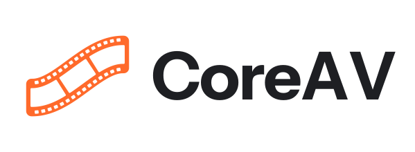

<h1 align="center">
  
</h1>

<h3 align="center">The modern FFmpeg alternative</h3>

<p align="center">A Rust-based media toolkit, built to be safe and fast.</p>

<p align="center">
  <a href="https://coreav.dev/docs">Documentation</a> ·
  <a href="https://coreav.dev/docs/measurements">Measurements</a> ·
  <a href="https://github.com/coreav-dev/coreav">GitHub</a>
</p>

## Highlights

- **Safe.** Every container parser is safe Rust with limits on memory and work, so a damaged or hostile file gives an error, never a crash. [Safety](https://coreav.dev/docs/safety)
- **Fast.** CoreAV reads only the bytes a job needs, from a local file or an `https://` URL, and every speed claim is measured against FFmpeg in the open. [Measurements](https://coreav.dev/docs/measurements)
- **Drop-in.** `coreav ffprobe` and `coreav ffmpeg` take the command lines your scripts already run, and hand any line CoreAV doesn't run natively to the FFmpeg installed on the machine. [Commands](https://coreav.dev/docs/commands)
- **Everywhere.** Native binaries for Linux, macOS and Windows, and an npm package that runs as WebAssembly wherever else Node.js runs. [Platforms](https://coreav.dev/docs/platforms)

## Installation

Today you can only build CoreAV from source. Release binaries and the npm package come with 0.1.0.

With Rust 1.89 or later, git, and a C compiler installed:

```sh
git clone https://github.com/coreav-dev/coreav
cd coreav
cargo install --locked --path crates/coreav-cli --profile dist
```

Cargo puts `coreav` in `~/.cargo/bin`. [Install](https://coreav.dev/docs/install) covers build features and the planned npm and GitHub Releases packages.

### Install scripts with pnpm and Bun

The npm package needs Node.js 20 or later. Without install scripts, its Node.js launcher still runs the native binary, or WebAssembly where no native package exists. On Linux and macOS, allowing the install script makes `coreav` start the native binary directly instead. The script uses the installed platform package and downloads nothing.

For pnpm, follow the [version-specific approval settings](https://coreav.dev/docs/platforms#install-scripts), preserving any existing approvals, then run `pnpm rebuild coreav`.

For Bun, run `bun pm trust coreav` in the project. This runs the script and adds `coreav` to `trustedDependencies` in `package.json` for future installs.

[Platforms](https://coreav.dev/docs/platforms) covers the native and WebAssembly builds.

After removing optional dependencies with `npm prune --omit=optional`, run `npm rebuild coreav` to restore the Node launcher, which falls back to WebAssembly.

## Usage

```sh
coreav probe input.mp4                               # describe the file as JSON
coreav clip --start 10 --end 20 input.mp4 clip.mp4   # cut at keyframes
coreav remux input.mkv output.mp4                    # Matroska to MP4, movie header first
coreav ffprobe -v error -show_streams input.mp4      # the ffprobe command line you already use
```

For files you didn't make, such as uploads, add `--strict-safe` (`coreav --strict-safe ffprobe ...`): CoreAV then refuses any command line it doesn't run natively instead of handing it to FFmpeg. [Strict-safe mode](https://coreav.dev/docs/strict-safe)

## Documentation

CoreAV's documentation is at [coreav.dev/docs](https://coreav.dev/docs), and `coreav --help` lists every command. [Commands](https://coreav.dev/docs/commands) covers outputs, exit statuses and errors.

## License

Licensed under either the MIT license or the Apache License 2.0, at your option. Source: <https://github.com/coreav-dev/coreav>.
